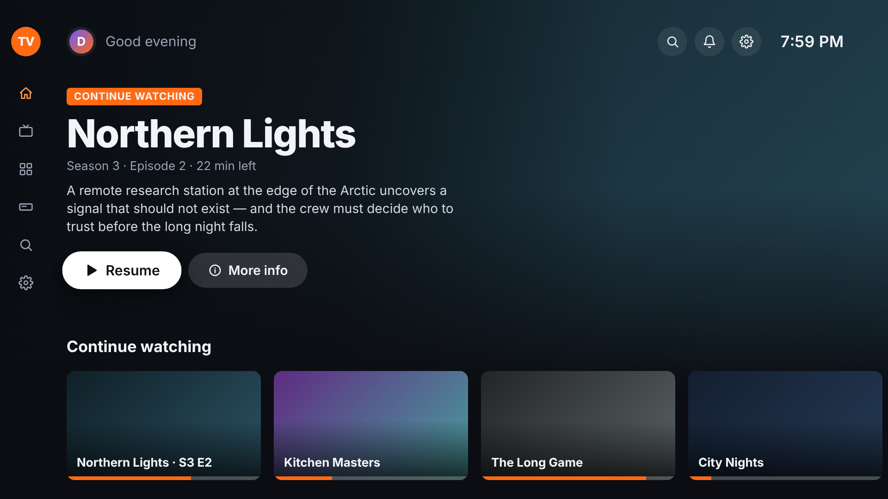

# TV Home — Fire TV layout

An ad-free home-screen layout for Amazon Fire TV (Fire TV Cube, Fire OS). The layout is plain HTML/CSS/JS at 1920×1080 in `web/`, packaged as a small Android app that shows it in a full-screen WebView.



## Layout

```
┌──────┬───────────────────────────────────────────────────────────┐
│      │  Greeting · Profile                    Search Bell ⚙ 9:41 │  top bar
│  TV  │                                                           │
│      │  CONTINUE WATCHING                                        │
│ Home │  Northern Lights                                          │  resume panel
│ Live │  Season 3 · Episode 2 · 22 min left                       │  (last thing watched)
│ Apps │  [▶ Resume]  [ⓘ More info]                                │
│ Inp. │                                                           │
│ Srch │  Continue watching  ▭ ▭ ▭ ▭  (progress bars)              │
│ Sett │  Apps               ▢ ▢ ▢ ▢ ▢ ▢                           │  rows
│      │  Inputs             Cube HDMI · TV HDMI 2 · TV HDMI 3 …   │  (scroll with focus)
└──────┴───────────────────────────────────────────────────────────┘
```

- **Left rail**: shows only icons, and expands to show labels while it has focus. Moving right out of it goes back to where you were.
- **Resume panel**: the last thing watched, which also tints the background.
- **Rows**: Continue watching, Apps and Inputs. The Fire TV Cube has one HDMI input of its own and switches the TV's inputs over HDMI-CEC/IR.
- **Details window** and **exit confirmation**: focus stays inside them while open.
- **Safe area**: 5% overscan margins (96px / 54px), following Fire TV's UI guidelines.

## No ads

This layout has no ads, promoted titles, sponsored tiles or recommendations. It shows only your own content, apps and inputs. If a data source ever marks an item `sponsored: true` or `promoted: true`, `web/js/app.js` drops it before rendering (and drops any row that ends up empty).

This app doesn't change the ads on Fire TV's own home screen. Since updates in late 2023, Fire OS blocks third-party apps from replacing the home screen, so this app opens like any other app. To cut down ads and tracking in Fire OS itself (menu names vary by Fire OS version):

- **Settings → Preferences → Privacy Settings**: turn off *Interest-based Ads*, *Device Usage Data* and *Collect App Usage Data*.
- **Settings → Preferences → Featured Content**: turn off *Allow Video Autoplay* and *Allow Audio Autoplay*.

The banner ads on the Fire TV home screen itself can't be turned off in settings.

## Remote control

| Fire TV remote | Action |
| --- | --- |
| D-pad | Spatial navigation (`web/js/navigation.js`) |
| Select | Select |
| Play/Pause | Select the focused item |
| Back | Close a pop-up, then return to the top, then show the exit dialog |

Back never reaches a WebView page, so `MainActivity` catches it and calls `Nav.back()`. Exiting calls `FireTV.exit()`, a bridge that closes the activity. In a desktop browser, Backspace and Esc act as Back.

## Project structure

```
web/                      the layout (also opens directly in a desktop browser)
  index.html
  css/styles.css          layout, focus states, theme tokens
  js/icons.js             inline SVG icon set
  js/data.js              rail and row content (replace with real data)
  js/navigation.js        D-pad spatial navigation
  js/app.js               rendering, scrolling, ad filter, pop-ups, clock
app/                      Android wrapper for Fire OS
  build.gradle            bundles ../web as APK assets; minSdk 22 (Fire OS 5+)
  src/main/AndroidManifest.xml   leanback launcher entry, Fire TV banner
  src/main/java/com/tvproject/home/MainActivity.java   WebView host + Back/exit bridge
  src/main/res/drawable-xhdpi/   banner.png (320×180), ic_launcher.png
```

## Run

**Browser:** open `web/index.html`. The stage scales to fit any window size.

**Fire TV Cube:** you need the Android SDK, either through Android Studio or with `sdk.dir` set in `local.properties`.

1. Build: `./gradlew assembleDebug`
2. On the Cube, open **Settings → My Fire TV → About** and select the device name 7 times to unlock **Developer Options**. Then turn on **ADB debugging**.
3. Find the Cube's IP address under **Settings → My Fire TV → About → Network**, then:

```sh
adb connect <cube-ip>:5555
adb install -r app/build/outputs/apk/debug/app-debug.apk
adb shell am start -n com.tvproject.home/.MainActivity
```

The app also appears in **Your Apps & Channels** on the Fire TV home screen.
